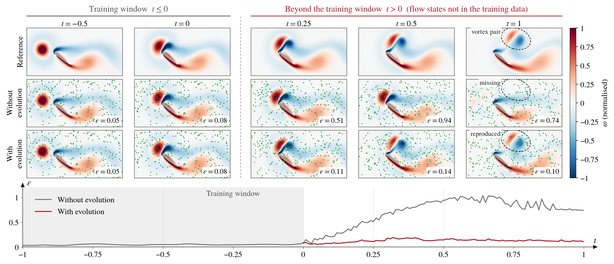

# Evolutional Sensor Reconstruction

Sample code for the reconstruction of vortex-gust–aerofoil interactions from moving sensors, in which the parameters of a trained reconstruction model are evolved in time with the sensor readings.

The framework has two stages:

1. **train** — the model $`\mathcal{F}(\boldsymbol{s}, \mathcal{X}; \boldsymbol{W})`$ is trained on the snapshots within the training window, with the sensor layout $`\mathcal{X}`$ drawn at random for every mini-batch.
2. **evolve** — beyond the training window, the parameters $`\boldsymbol{W}(t)`$ are updated at every time step from the readings of sensors that move by a random walk:

```math
\dot{\boldsymbol{W}}_n = \arg\min_{\dot{\boldsymbol{W}}} \left\| \boldsymbol{J}_{n+1} \dot{\boldsymbol{W}} - \boldsymbol{r}_{n+1} \right\|_2^2,
\qquad
\boldsymbol{r}_{n+1} = \frac{\boldsymbol{s}_{n+1} - \hat{\boldsymbol{s}}_{n+1}(\boldsymbol{W}_n)}{\Delta t},
\qquad
\boldsymbol{W}_{n+1} = \boldsymbol{W}_n + \Delta t\, \dot{\boldsymbol{W}}_n .
```

The Jacobian $`\boldsymbol{J}_{n+1}`$ is applied matrix-free by forward- and reverse-mode automatic differentiation, and the least-squares problem is solved with LSMR. An edge-preserving smoothness penalty can optionally be added.

The model is trained only on the flow before the gust reaches the aerofoil, and the flow states after the encounter do not appear in the training data. Beyond the training window, a model whose parameters stay fixed keeps producing states similar to those before the encounter, while the evolved model follows the new states from the readings of moving sensors (dots):



*2D vortex gust–aerofoil interaction with $`n_s = 256`$ sensors and the sensor walk step $`n_w = 32`$, trained on $`t \in [-2, 0]`$ and evolved over $`t \in (0, 1]`$. Within the training window the parameters are not yet evolved, so the two rows are the same model. Beyond it, both models read the same sensors at the same locations. $`\varepsilon`$ is the relative $`L_2`$ error outside the aerofoil, shown over time in the bottom panel; the training window starts at $`t = -2`$ and is shown from $`t = -1`$. The dashed ellipse marks the same region in the three rows at $`t = 1`$.*

## Installation

```
uv sync
```

The dependencies are pinned (JAX 0.11.0 with CUDA 12).

## Data

Each data set is one `.npz` file with

| key | shape | content |
|---|---|---|
| `snapshots` | $`(T, \text{grid}, n_c)`$ | the field: vorticity $`\omega`$ in 2D ($`n_c = 1`$), velocity $`(u, v, w)`$ in 3D ($`n_c = 3`$) |
| `t` | $`(T,)`$ | sampling times |
| `interior_mask` | grid | true inside the aerofoil |

The grid is $`(y, x)`$ in 2D and $`(z, y, x)`$ in 3D, with a uniform spacing. The configs expect the files under `data/`:

| file | used by |
|---|---|
| `data/g2.npz` | `configs/ex1_g2_nsnw` |
| `data/g2_x-1.npz` | `configs/ex1_g2_window` |
| `data/gm2.npz` | `configs/ex2_gm2_smooth` |
| `data/g2_3d.npz` | `configs/ex3_3d_noise` |

## Usage

Single runs:

```
uv run train configs/ex1_g2_nsnw/train.yaml --out out/ex1_g2_nsnw/train/n_s128_val_fold1
uv run evolve configs/ex1_g2_nsnw/evolve.yaml --out out/ex1_g2_nsnw/evolve/n_s128_val_fold1/n_w64
```

Any config value can be overridden with `--set section.key=value`, e.g. `--set train.n_s=64 train.val_fold=2`.

Each experiment directory has a `sweep.yaml` listing the values to be varied. `scripts/run_sweep.py` expands it into the commands:

```
uv run python scripts/run_sweep.py configs/ex1_g2_nsnw          # print the commands
uv run python scripts/run_sweep.py configs/ex1_g2_nsnw --run    # run them one after another
```

| experiment | sweep |
|---|---|
| `ex1_g2_nsnw` | $`n_s`$ × fold (training), $`n_w`$ (evolution); $`\lambda_s = 1`$, $`\sigma_s = 0.1`$ for $`n_s = 128`$, fold 1 |
| `ex1_g2_window` | $`t_e`$ × fold (training), sensor walks (evolution, fold 1) |
| `ex2_gm2_smooth` | sensor walks, $`\lambda_s \times \sigma_s`$ (evolution) |
| `ex3_3d_noise` | fold (training), $`\sigma_n`$ (evolution) |

### Outputs

- `train`: `config.yaml`, `params.npz` (the weights with the smallest validation loss), `info.json` (grid, $`n_c`$ and the initial sensor layout), `losses.json`.
- `evolve`: `config.yaml` and `evolution.npz` with, for every evolved snapshot, the time `t`, the reconstruction `q_hat` (in the units of the data), the sensor locations `sensors` (flat grid indices) and the relative $`L_2`$ error `eps` over the region outside the aerofoil.

## Configuration

`train.yaml` has the sections `data`, `model` and `train`; `evolve.yaml` has the section `evolve`, and the evolution reads the rest from the trained model's `config.yaml`.

| key | symbol | meaning |
|---|---|---|
| `data.norm_scale` | | the model sees $`q`$ × `norm_scale` |
| `data.periodic_axes` | | grid axes that wrap around (the span in 3D) |
| `data.sensor_margin` | | sensors keep this many cells away from the aerofoil |
| `model.n_freq` | | frequencies $`2^k`$, $`k \lt`$ `n_freq`, of the Fourier positional encoding |
| `model.feature_dim` | | width of the per-sensor feature $`\boldsymbol{e}_i`$ |
| `model.decoder_shapes`, `decoder_channels` | | grid and channels of each convolutional stage, coarsest first |
| `train.n_s` | $`n_s`$ | number of sensors |
| `train.n_layouts_per_batch` | | random sensor layouts drawn for every mini-batch |
| `train.layout_seed` | | seed of the layout used for validation and at the start of the evolution |
| `train.train_window` | $`[t_0, t_e]`$ | training window |
| `train.train_stride` | | every `train_stride`-th snapshot of the window, counted back from $`t_e`$ |
| `train.n_folds`, `val_fold` | | cross-validation split of the training snapshots |
| `train.lr_final_ratio` | | cosine decay of the learning rate to this fraction; 1 keeps it constant |
| `evolve.model_dir` | | output directory of `train` |
| `evolve.evolve_window` | | $`\boldsymbol{W}`$ is evolved from the first to the second time |
| `evolve.n_w` | $`n_w`$ | sensor walk step in grid cells; 0 keeps the sensors fixed |
| `evolve.walk_seed` | | seed of the sensor walk |
| `evolve.lsmr_iters` | | iteration limit of LSMR |
| `evolve.lambda_s` | $`\lambda_s`$ | weight of the smoothness penalty; 0 disables it |
| `evolve.sigma_s` | $`\sigma_s`$ | edge threshold of the penalty, relative to the median gradient |
| `evolve.sigma_n` | $`\sigma_n`$ | standard deviation of the sensor noise, in the units of the data |
| `evolve.noise_seed` | | seed of the sensor noise |
